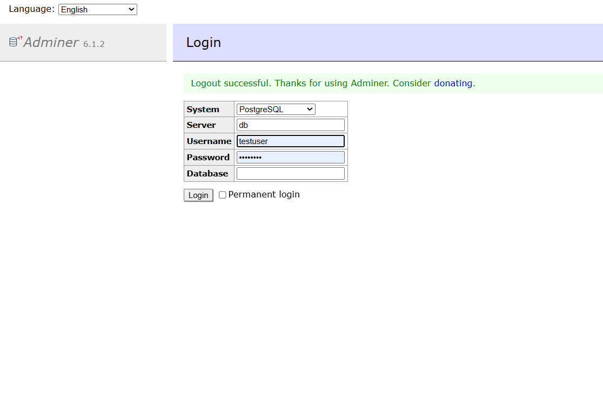
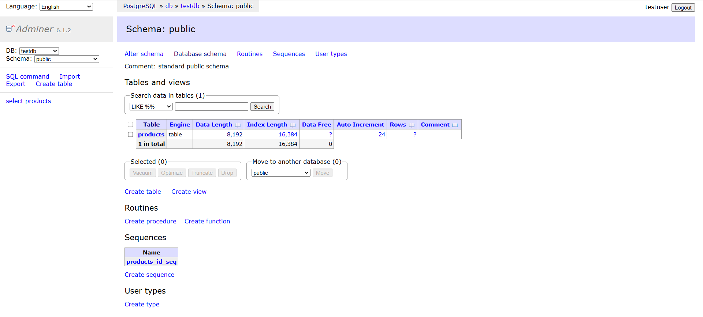

# Docker Compose Demo — Multi-Container QE Infrastructure

## Project Description
In this project, I did the following:
- **Run the demo**: Cloned/copied the docker-compose-demo folder. Run docker compose up --build --abort-on-container-exit. Verified tests pass and report.html appears.
- **Added a test to create a new product and verify it exists**: Added new test to test_product_api.py that creates a product, then fetches ALL products and verifies the new one is in the list. Run via docker compose.
- **Wired into GitHub Actions**: Created a .github/workflows/docker-tests.yml that runs docker compose up --build --abort-on-container-exit in CI. Uploaded reports/ as an artifact.
- **Added an Adminer container**: Researched and added an Adminer container (a web UI for PostgreSQL). Connected it to the same 'db' service. After docker compose up, I opened http://localhost:8080 and see the test data in the database visually.

Below are screenshots of my Adminer container:



## What This Is
A complete working example of 3 Docker containers working together:
- **db** — PostgreSQL database (seeded with test data)
- **api** — Flask mock API server (CRUD for products)
- **test-runner** — pytest suite that validates the API

## Prerequisites
- Docker Desktop installed (https://www.docker.com/products/docker-desktop/)

## Run Everything (One Command)
```bash
docker compose up --build --abort-on-container-exit
```

## View the Test Report
After tests finish, open: `reports/report.html`

## Useful Commands
```bash
# Run tests only (after first build)
docker compose up test-runner

# Rebuild everything from scratch
docker compose build --no-cache

# Tear down everything
docker compose down -v

# Check what's running
docker compose ps

# See logs from a specific container
docker compose logs api
docker compose logs db
```

## Architecture
```
┌──────────────┐     ┌──────────────┐     ┌──────────────┐
│   db         │     │   api        │     │  test-runner  │
│  PostgreSQL  │◄────│  Flask API   │◄────│   pytest      │
│  Port 5432   │     │  Port 5000   │     │              │
└──────────────┘     └──────────────┘     └──────────────┘
     Container 1          Container 2          Container 3
```
